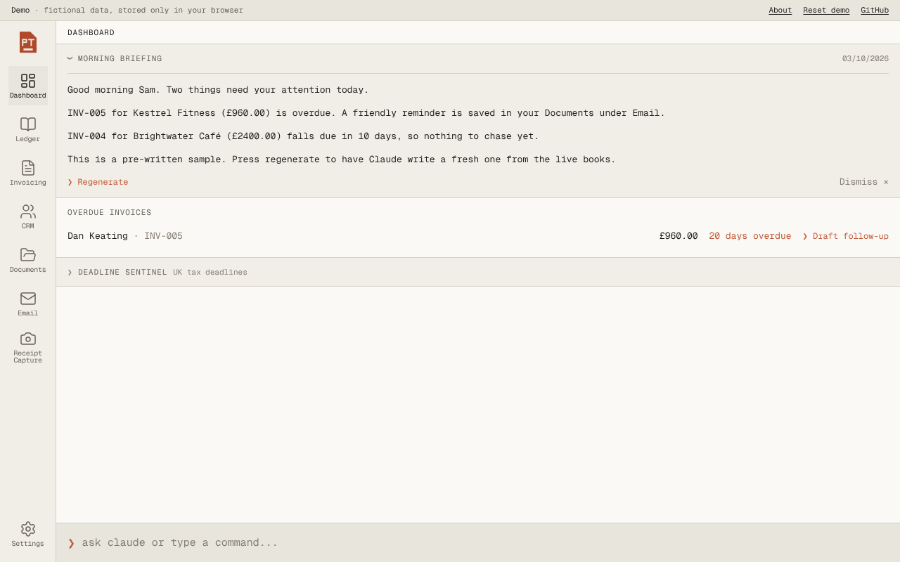
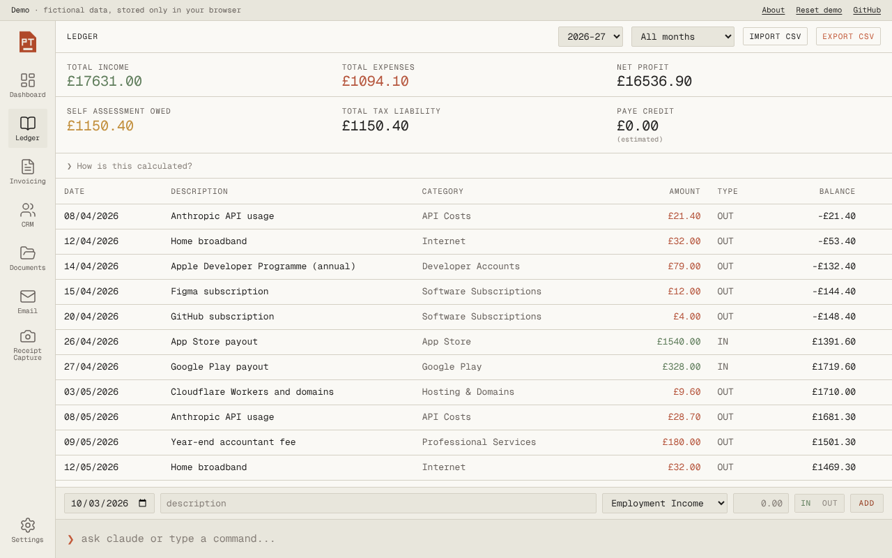
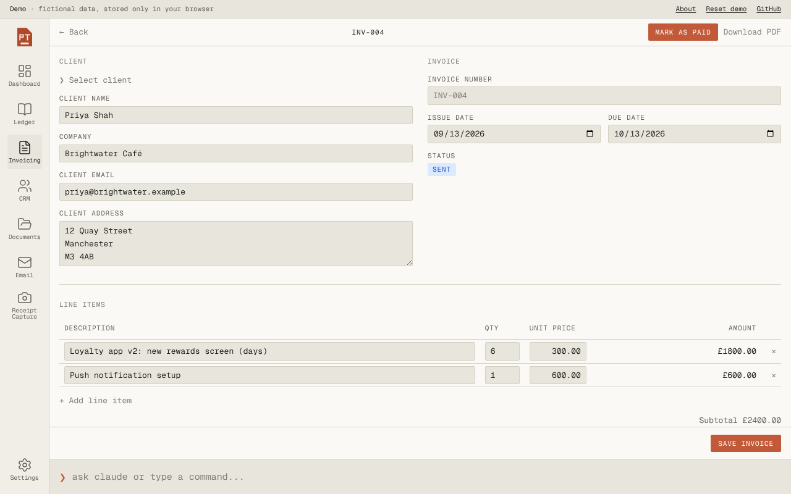

# Paper Terminal

A small business suite for UK sole traders: a ledger with a Self Assessment tax estimate, invoicing with PDF export, a client list, documents, receipt capture by photo, and a Claude command bar that can read and write the books.

**Live demo:** https://paperterminal.insightio.co.uk (no sign-in, fictional data stored only in your browser)



## About this project

I'm a chef, not a software engineer. I built Paper Terminal with Claude and Cursor to see how far a real working product can go when a non-developer drives the design and the AI helps write the code. It started as a private app with real accounts and payments. This repository is the public demo version.

## What it does

- **Ledger:** income and expenses by UK tax year, with a Self Assessment estimate (income tax, National Insurance, PAYE credit).
- **Invoicing:** drafts, sent, overdue and paid, with automatic overdue detection and PDF download. Marking an invoice paid logs it to the ledger.
- **Claude command bar:** natural-language commands such as "add a £24 software expense for today" or "who owes me money?". Claude calls tools that read and write the same data as the screens.
- **Morning briefing:** a short daily summary of the books, with overdue invoices and UK tax deadlines.
- **Receipt capture:** photograph a receipt and Claude reads the vendor, date, amount and category for you to confirm.
- **Clients and documents:** a small CRM and a place for proposals, contracts and email templates.

| Ledger | Invoice |
| --- | --- |
|  |  |

## How this demo differs from the real app

| Real app | This demo |
| --- | --- |
| Supabase accounts, Turnstile captcha, row-level security | No sign-in. A fictional business is loaded into your browser. |
| Data in Postgres | Data in `localStorage`. "Reset demo" restores the sample data. |
| Stripe Checkout, customer portal and verified webhooks in a Worker | A clearly labelled mock of the checkout step. Nothing is charged. |
| Claude calls authenticated per user | Claude calls go through a locked-down Worker (below). |

## Engineering notes

- **Repository pattern.** Screens and stores talk to interfaces in `src/lib/repository/types.ts`. The original used Supabase implementations; this demo swaps in browser-storage ones (`src/lib/repository/demo`) without touching a single screen.
- **Money is integer pence** everywhere, with decimal-string parsing instead of `parseFloat * 100`. The tax calculations and money helpers have unit tests (`npm test`).
- **Claude tool use.** The command bar runs a bounded tool loop (`src/ai/toolLoop.ts`) over a small set of tools (`src/ai/tools.ts`). The model never does the arithmetic on receipts: it transcribes the printed total and the Worker converts it to pence.
- **A public AI endpoint needs defending.** With sign-in removed, `worker/worker.js` is the only thing standing between the internet and my API key, so it enforces, server-side:
  - an exact-match origin allowlist and POST only
  - a fixed model and token cap, plus a guard system prompt that keeps Claude on bookkeeping
  - tool names limited to the app's own, with message, system prompt, body and image size caps
  - per-visitor and global daily request counters in Workers KV

## Run it locally

```bash
npm install
cp .env.example .env.local     # set VITE_DEMO_API_URL
npm run dev
```

`npm test` runs the unit tests, and `npm run build` type-checks and builds.

### Deploy your own Worker

```bash
cd worker
npx wrangler kv namespace create LIMITS   # paste the id into wrangler.toml
npx wrangler secret put ANTHROPIC_API_KEY
npx wrangler deploy
```

Edit `ALLOWED_ORIGINS` and the route in `worker/wrangler.toml` for your own domain.

## Stack

React 19, TypeScript, Vite, Tailwind 4, Zustand, jsPDF, Cloudflare Workers and KV, Anthropic API.

All people, businesses and figures in the demo are fictional.
